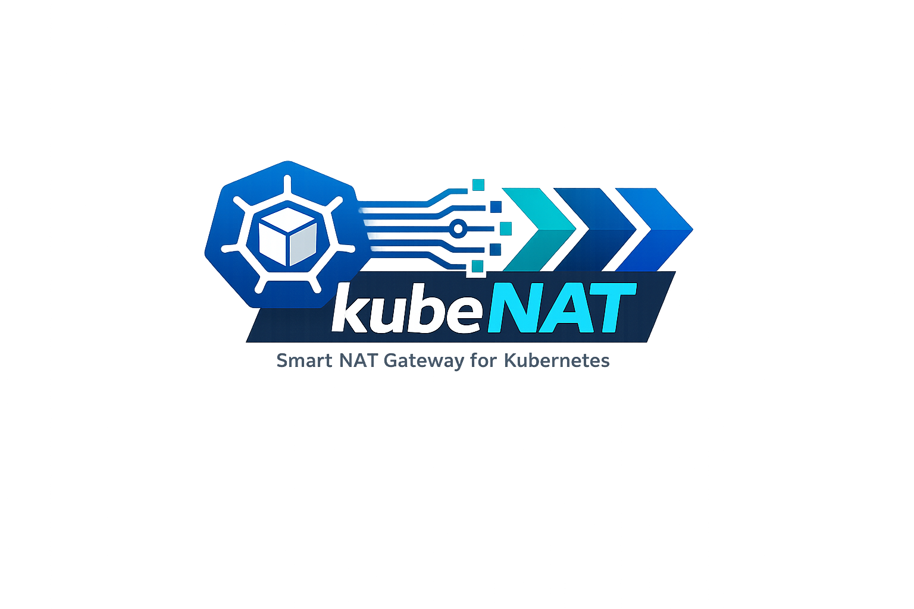

<p align="center">
  
</p>

# kube-nat

kube-nat replaces AWS NAT Gateways with a self-managed iptables MASQUERADE DaemonSet on EC2 worker nodes. Pods on private subnets reach the internet through the kube-nat agent in their availability zone, which performs SNAT via the instance's existing Elastic IP — no NAT Gateway required.

---

## Changelog

### v0.1.21 (2026-10-16)

- `Renew` now retries on a resourceVersion conflict instead of reporting that the agent lost its own Lease, so an agent's lease loop and reconcile loop refreshing the same Lease at the same moment no longer logs a misleading "acquired own lease" on every reconcile tick. A conflict that reveals a different holder is still treated as a loss (renewal never steals).

### v0.1.20 (2026-10-16)

- **Route-table flapping on NAT-node replacement fixed.** The own-AZ route claim is now gated on the AZ's Lease, so when two agents briefly share an AZ — a draining NAT node and its replacement (e.g. Karpenter), or a rolling restart — only the Lease holder points the route table at itself. Previously both agents re-claimed the route every reconcile tick, so `0.0.0.0/0` flapped between the old and new instance.
- **A draining node's agent now stands down.** When an agent's node is cordoned or marked for disruption, the agent releases its AZ Lease and stops claiming the route table, so the replacement (or a peer) takes over instead of competing. A DaemonSet is always scheduled onto cordoned nodes (the controller force-adds a `node.kubernetes.io/unschedulable` toleration), so this is enforced by the agent itself rather than by a scheduling rule. Configurable via `agent.standDownOnDrain` / `KUBE_NAT_STAND_DOWN_ON_DRAIN` (default on).
- Agent tolerations are now explicit (`node-role.kubernetes.io/nat`) instead of a blanket `operator: Exists` `NoSchedule` toleration; the DaemonSet controller still adds the standard node-condition tolerations.
- `/readyz` now reports the data plane only (masquerade + forwarding). Whether an agent currently *serves* its AZ is reported separately by the new `kube_nat_standby` gauge and `kube_nat_route_table_owned`.

### v0.1.18 (2026-06-30)

- Dashboard now shows the running server version in the header next to Dashboard (for example: `Dashboard v0.1.27`).
- Added `KUBE_NAT_SERVER_VERSION` wiring so dashboard snapshots include `server_version`, with Helm setting it from `image.tag`.

### v0.1.17 (2026-06-30)

- AWS route updates now use explicit upsert semantics for `0.0.0.0/0`: the agent tries `CreateRoute` first and falls back to `ReplaceRoute` when the route already exists.
- This avoids failures when there is no existing route to replace and makes reconciliation resilient to route-table drift.

---

## Why replace NAT Gateway?

### The cost problem

AWS NAT Gateway charges on two axes that compound quickly:

| Charge | Rate |
|---|---|
| Per NAT Gateway per hour | $0.045 |
| Per GB of data processed | $0.045 |

A standard highly-available setup runs one NAT Gateway per AZ. On a three-AZ cluster:

| Scenario | NAT Gateway/month | kube-nat/month | Monthly saving |
|---|---|---|---|
| 3 AZs, 500 GB outbound | $97.20 fixed + $22.50 data = **$119.70** | ~$15 (3× spot t3.small) | **$104** |
| 3 AZs, 2 TB outbound | $97.20 + $90 = **$187.20** | ~$15 | **$172** |
| 3 AZs, 10 TB outbound | $97.20 + $450 = **$547.20** | ~$15 | **$532** |
| 3 AZs, 50 TB outbound | $97.20 + $2,250 = **$2,347.20** | ~$15 | **$2,332** |

_kube-nat cost shown using spot t3.small instances — on-demand works too. Data processing through EC2 is free; you only pay for instance-hours. Prices as of 2025, us-east-1._

### Other advantages over NAT Gateway

- **No cross-AZ data transfer charges.** Traffic stays within the AZ — the kube-nat agent is always co-located with the pods it serves.
- **Observability.** NAT Gateway gives you CloudWatch metrics with 1-minute granularity. kube-nat exposes per-agent Prometheus metrics and a real-time dashboard with 5-second resolution.
- **No AWS service limits.** NAT Gateway has a fixed 100 Gbps bandwidth cap per gateway. kube-nat throughput scales with the instance type you choose.
- **Spot-safe.** Failover is coordinated by a per-AZ Kubernetes Lease. A graceful step-down (spot notice → SIGTERM → TCP heartbeat) releases the lease first, so a peer takes over within about a second; an ungraceful failure fails over once the lease expires (`KUBE_NAT_LEASE_DURATION`).

---

## How it works

```
┌─────────────────────── AZ eu-west-1a ──────────────────────────┐
│                                                                  │
│  ┌──────────┐    iptables MASQUERADE    ┌────────────────────┐  │
│  │  pod     │ ─────────────────────────▶│  kube-nat agent    │─▶ internet
│  │ 10.0.1.5 │                           │  (EC2 instance)    │  │
│  └──────────┘                           │  EIP: 1.2.3.4      │  │
│                                         └────────────────────┘  │
└──────────────────────────────────────────────────────────────────┘
```

Each kube-nat agent:

1. **Owns its AZ.** The agent runs on the NAT instance in its AZ and points that AZ's route table at itself — but only while it holds that AZ's **Lease**. If two agents ever share an AZ (a draining node and its replacement, or a rolling restart), the Lease holder serves and the other stands by, so the own-AZ route can never flap between them.
2. **Coordinates through a Kubernetes Lease** (`coordination.k8s.io/v1`), one per AZ, recording the holder and the holder's home AZ. The same Lease both picks the single serving agent per AZ and gates *failover*: a surviving agent may only claim a failed AZ's route table once that AZ's Lease is absent or expired, and a returning owner always preempts a failover holder.
3. **Programs iptables** with a `MASQUERADE` rule on the host network interface so pod traffic SNATs to the instance's EIP.
4. **Manages EC2 route tables** (in `auto` mode) to insert a `0.0.0.0/0` route via the instance ENI into all subnets in its AZ.
5. **Broadcasts TCP heartbeats** every 200ms to peer agents. Two missed beats (~400ms) trigger a takeover *attempt*, which only succeeds if the failed AZ's Lease is absent or expired — so a healthy-but-slow agent is never stolen from.
6. **Watches for spot interruption notices** via the EC2 instance metadata service. On a two-minute notice (or SIGTERM) the agent gracefully steps down: it releases the AZ's Lease first, then tells its peers to take over, so a peer acquires the Lease and claims the route immediately instead of waiting for it to expire.
7. **Stands down when its node drains.** If its node is cordoned or marked for disruption (e.g. by Karpenter before a replacement), the agent releases its AZ's Lease and stops claiming the route table, so the replacement or a peer takes over cleanly.

### Failover layers

| Layer | Trigger | Effect |
|---|---|---|
| Spot notice watcher | EC2 metadata `/spot/termination-time` polled every 5s | graceful step-down; Lease released ~immediately |
| SIGTERM handler | node drain / pod eviction | graceful step-down; Lease released ~immediately |
| Node-drain watcher | node cordoned or marked for disruption (polled every 5s) | stand-down; Lease released ~immediately, route claims stop |
| TCP peer heartbeat | 2 missed beats × 200ms interval | takeover attempt (~400ms); succeeds once the peer's Lease is absent/expired |

A graceful step-down fails over in about a second. An ungraceful failure (crash, hard termination) fails over within `KUBE_NAT_LEASE_DURATION`, when the dead owner's Lease expires.

### Components

| Component | Kind | Purpose |
|---|---|---|
| `kube-nat agent` | DaemonSet | iptables, EC2 routes, lease, peer heartbeats, spot watcher |
| `kube-nat dashboard` | Deployment | Prometheus scraper + WebSocket server + React SPA |

---

## Prerequisites

- Kubernetes 1.25+ on AWS EKS
- Any node provisioner or autoscaler (Karpenter, Cluster Autoscaler, managed node groups, etc.)
- Each NAT node must have:
  - An Elastic IP associated with its primary network interface
  - `src/dst check` disabled on the ENI (required for MASQUERADE to work)
  - Outbound route to the internet on its subnet
- An IAM role with permissions to modify route tables, reachable via IRSA:

```json
{
  "Version": "2012-10-17",
  "Statement": [
    {
      "Effect": "Allow",
      "Action": [
        "ec2:DescribeRouteTables",
        "ec2:CreateRoute",
        "ec2:ReplaceRoute",
        "ec2:DeleteRoute"
      ],
      "Resource": "*"
    }
  ]
}
```

---

## Quick start

### 1. Label the NAT nodes

kube-nat agents only run on nodes labelled `node-role.kubernetes.io/nat=true`. Apply this label however suits your setup — node group launch template userdata, a `MutatingWebhook`, or manually:

```bash
kubectl label node <node-name> node-role.kubernetes.io/nat=true
```

### 2. Install with Helm

```bash
helm upgrade --install kube-nat \
  oci://ghcr.io/mfeldheim/kube-nat/helm/kube-nat \
  --namespace kube-nat \
  --create-namespace \
  --set agent.irsaRoleArn=arn:aws:iam::123456789012:role/kube-nat \
  --set image.tag=v0.1.0
```

Or with a values file:

```bash
helm upgrade --install kube-nat oci://ghcr.io/mfeldheim/kube-nat/helm/kube-nat \
  --namespace kube-nat \
  --create-namespace \
  -f my-values.yaml
```

### 3. Verify

```bash
# Agents should be Running on every NAT node
kubectl get pods -n kube-nat -o wide

# Check which agent owns each AZ
kubectl get leases -n kube-nat

# Open the dashboard
kubectl port-forward -n kube-nat svc/kube-nat-dashboard 8080:8080
# then visit http://localhost:8080
```

---

## Configuration reference

### Helm values

```yaml
image:
  repository: ghcr.io/mfeldheim/kube-nat  # container image
  tag: latest                              # image tag (pin to a version in production)
  pullPolicy: IfNotPresent

namespace: kube-nat                        # namespace for all resources

agent:
  irsaRoleArn: ""                          # REQUIRED: IAM role ARN for EC2 route table access
  mode: auto                               # "auto" = manage EC2 routes; "manual" = iptables only
  conntrackMax: ""                         # override nf_conntrack_max (empty = kernel default)
  tagPrefix: kube-nat                      # prefix for EC2 resource tags
  standDownOnDrain: true                   # a draining node's agent releases its AZ lease and stops claiming routes
  nodeSelector:
    node-role.kubernetes.io/nat: "true"    # nodes where agents are scheduled
  tolerations:                             # NAT node taint (the DaemonSet controller adds the rest)
    - key: node-role.kubernetes.io/nat
      operator: Exists
      effect: NoSchedule
  resources:
    requests: {cpu: 50m, memory: 64Mi}
    limits:   {cpu: 200m, memory: 128Mi}

dashboard:
  replicas: 1
  scrapeInterval: 5s                       # how often to scrape agent /metrics
  port: 8080
  resources:
    requests: {cpu: 20m, memory: 32Mi}
    limits:   {cpu: 100m, memory: 128Mi}

serviceMonitor:
  enabled: false                           # enable if Prometheus Operator is installed
  interval: 30s
```

### Agent environment variables

All agent configuration is also available as environment variables (Helm injects them automatically):

| Variable | Default | Description |
|---|---|---|
| `KUBE_NAT_MODE` | `auto` | `auto` manages EC2 routes; `manual` iptables only |
| `KUBE_NAT_TAG_PREFIX` | `kube-nat` | Prefix for EC2 resource tags |
| `KUBE_NAT_CONNTRACK_MAX` | _(kernel default)_ | Override `nf_conntrack_max` sysctl |
| `KUBE_NAT_LEASE_DURATION` | `30s` | How long an AZ's Lease is valid without renewal; also the upper bound on ungraceful failover time |
| `KUBE_NAT_PROBE_INTERVAL` | `200ms` | TCP heartbeat interval between peer agents |
| `KUBE_NAT_PROBE_FAILURES` | `2` | Missed heartbeats before a takeover **attempt** (the attempt still requires the peer's Lease to be absent or expired) |
| `KUBE_NAT_RECONCILE_INTERVAL` | `30s` | How often to reconcile iptables and routes, retry failed takeovers, and sweep for expired Leases |
| `KUBE_NAT_STAND_DOWN_ON_DRAIN` | `true` | Stand down (release the AZ Lease, stop claiming routes) while the node is cordoned or marked for disruption |
| `KUBE_NAT_DRAIN_POLL_INTERVAL` | `5s` | How often the node's drain state is checked |
| `KUBE_NAT_METRICS_PORT` | `9100` | Port for Prometheus metrics and health endpoints |
| `KUBE_NAT_PEER_PORT` | `9101` | Port for inter-agent TCP heartbeats |
| `KUBE_NAT_AZ_LABEL` | `topology.kubernetes.io/zone` | Node label used to determine the agent's AZ |
| `POD_NAMESPACE` | `kube-system` | Kubernetes namespace (injected by Helm) |

### Dashboard environment variables

| Variable | Default | Description |
|---|---|---|
| `KUBE_NAT_SCRAPE_INTERVAL` | `5s` | How often the dashboard scrapes agent pods |
| `KUBE_NAT_DASHBOARD_PORT` | `8080` | HTTP port for the dashboard server |
| `POD_NAMESPACE` | `kube-nat` | Namespace to discover agent pods in |

---

## Prometheus metrics

All metrics are exposed on `:9100/metrics` by each agent pod.

| Metric | Type | Description |
|---|---|---|
| `kube_nat_bytes_tx_total` | Counter | Total bytes transmitted (SNAT'd outbound) |
| `kube_nat_bytes_rx_total` | Counter | Total bytes received (DNAT'd inbound) |
| `kube_nat_conntrack_entries` | Gauge | Current conntrack table entries |
| `kube_nat_conntrack_max` | Gauge | Maximum conntrack table capacity |
| `kube_nat_route_tables_owned` | Gauge | Number of EC2 route tables currently managed |
| `kube_nat_standby` | Gauge | 1 while this agent is not serving its own AZ (another agent holds the AZ Lease, or the node is draining) |
| `kube_nat_peer_up` | Gauge | 1 if TCP peer heartbeat is healthy, 0 otherwise |
| `kube_nat_spot_pending` | Gauge | 1 if a spot termination notice has been received |
| `kube_nat_rule_present` | Gauge | 1 if the iptables MASQUERADE rule is in place |
| `kube_nat_src_dst_disabled` | Gauge | 1 if src/dst check is confirmed disabled on the ENI |
| `kube_nat_last_failover_seconds` | Gauge | Unix timestamp of the last failover this agent performed |
| `kube_nat_failover_total` | Counter | Total number of failovers performed by this agent |

### Health endpoints

Each agent exposes two HTTP endpoints on `KUBE_NAT_METRICS_PORT`:

| Path | Ready when |
|---|---|
| `/healthz` | Process is alive |
| `/readyz` | The data plane (masquerade + forwarding) is applied |

`/readyz` deliberately does not depend on route ownership: a standby agent (one that is not currently holding its AZ's Lease) is healthy and ready, and keeping readiness independent of the Lease avoids stalling a DaemonSet rollout when two agents briefly share an AZ. Use `kube_nat_standby` and `kube_nat_route_table_owned` to see which agent is serving.

---

## Working examples

### Example: single-AZ cluster (dev/test)

For a simple single-AZ dev cluster, disable HA and use one agent:

```yaml
# values-dev.yaml
agent:
  irsaRoleArn: arn:aws:iam::123456789012:role/kube-nat-dev
  mode: auto
  nodeSelector:
    node-role.kubernetes.io/nat: "true"
  resources:
    requests: {cpu: 10m, memory: 32Mi}
    limits:   {cpu: 100m, memory: 64Mi}

dashboard:
  replicas: 0   # disable dashboard in dev
```

```bash
helm upgrade --install kube-nat oci://ghcr.io/mfeldheim/kube-nat/helm/kube-nat \
  --namespace kube-nat --create-namespace \
  -f values-dev.yaml
```

### Example: three-AZ production cluster

```yaml
# values-prod.yaml
image:
  tag: v0.1.0     # always pin to a specific version in production

agent:
  irsaRoleArn: arn:aws:iam::123456789012:role/kube-nat-prod
  mode: auto
  conntrackMax: "524288"    # tune for high-connection workloads
  nodeSelector:
    node-role.kubernetes.io/nat: "true"
  resources:
    requests: {cpu: 100m, memory: 64Mi}
    limits:   {cpu: 500m, memory: 256Mi}

dashboard:
  replicas: 1
  scrapeInterval: 5s

serviceMonitor:
  enabled: true   # scrape dashboard metrics from Prometheus Operator
```

```bash
helm upgrade --install kube-nat oci://ghcr.io/mfeldheim/kube-nat/helm/kube-nat \
  --namespace kube-nat --create-namespace \
  -f values-prod.yaml
```

### Example: manual mode (no IAM required)

`manual` mode programs iptables only and does not touch EC2 route tables. Use this when you manage routes externally (e.g., Transit Gateway, custom VPC routing).

```yaml
agent:
  mode: manual
  irsaRoleArn: ""   # no IAM role needed
```

You must configure the VPC route table to send `0.0.0.0/0` traffic to the NAT instance ENI yourself.

### Example: Prometheus scrape config (without Operator)

```yaml
# prometheus.yml
scrape_configs:
  - job_name: kube-nat
    kubernetes_sd_configs:
      - role: pod
        namespaces:
          names: [kube-nat]
    relabel_configs:
      - source_labels: [__meta_kubernetes_pod_label_app]
        regex: kube-nat
        action: keep
      - source_labels: [__meta_kubernetes_pod_label_component]
        regex: agent
        action: keep
      - source_labels: [__meta_kubernetes_pod_ip]
        target_label: __address__
        replacement: "$1:9100"
```

### Example: alert rules

```yaml
groups:
  - name: kube-nat
    rules:
      - alert: KubeNatAgentDown
        expr: kube_nat_rule_present == 0
        for: 1m
        labels:
          severity: critical
        annotations:
          summary: "kube-nat agent {{ $labels.pod }} has no iptables rule"

      - alert: KubeNatConntrackHigh
        expr: kube_nat_conntrack_entries / kube_nat_conntrack_max > 0.8
        for: 5m
        labels:
          severity: warning
        annotations:
          summary: "conntrack table >80% full on {{ $labels.pod }}"

      - alert: KubeNatPeerDown
        expr: kube_nat_peer_up == 0
        for: 30s
        labels:
          severity: warning
        annotations:
          summary: "kube-nat peer heartbeat down on {{ $labels.pod }}"
```

---

## FAQ

**Q: Does kube-nat work with Fargate nodes?**  
No. Fargate nodes do not expose the host network or allow iptables manipulation. kube-nat requires EC2 worker nodes.

**Q: Can I run kube-nat agents on on-demand instances?**  
Yes. The spot-interruption watcher is a no-op on on-demand instances. The failover mechanism still works for other failure modes.

**Q: What happens to existing connections during a failover?**  
Established TCP connections that are tracked in conntrack survive if the new agent takes over within the conntrack timeout (default: 432000s for established TCP). A graceful step-down fails over in about a second, which is transparent to most applications. An ungraceful failure fails over within `KUBE_NAT_LEASE_DURATION`. UDP and short-lived TCP connections may experience brief packet loss.

**Q: Why does the agent need `hostNetwork: true`?**  
iptables rules must be installed in the host network namespace to intercept pod traffic at the node level. Without `hostNetwork`, the agent would only see its own network namespace.

**Q: Why does the agent need `NET_ADMIN` and `NET_RAW` capabilities?**  
`NET_ADMIN` is required to add and remove iptables rules and modify sysctl values (`nf_conntrack_max`). `NET_RAW` is required to send raw TCP packets for the peer heartbeat protocol.

**Q: What is `manual` mode for?**  
When your VPC routing is managed externally (Transit Gateway, Direct Connect, custom routing appliances), set `mode: manual`. kube-nat will still manage the iptables MASQUERADE rule but will not create or modify EC2 route table entries.

**Q: How does kube-nat handle multiple agents in the same AZ?**  
Each AZ is owned by the agent running in it, which always points that AZ's route table at its own instance. A per-AZ Kubernetes Lease records ownership and gates failover: a surviving agent may only claim a failed AZ's route table once that AZ's Lease is absent or expired (`KUBE_NAT_LEASE_DURATION`, default 30s), and a returning owner preempts a failover holder. Because the own-AZ route target is always the same instance, the own-AZ route cannot flap between agents.

**Q: Does kube-nat support IPv6?**  
Not currently. kube-nat manages IPv4 MASQUERADE rules only.

**Q: Can I use a single NAT node for all AZs?**  
Yes, but cross-AZ traffic will incur AWS data transfer charges ($0.01/GB). For cost-optimal deployments, run one agent per AZ.

**Q: How do I migrate from NAT Gateway without downtime?**  
1. Deploy kube-nat in `manual` mode (no route table changes).
2. Verify agents are healthy and iptables rules are in place.
3. For each AZ, update the route table to point `0.0.0.0/0` at the kube-nat ENI instead of the NAT Gateway.
4. Once all AZs are migrated, delete the NAT Gateways.
5. Optionally switch to `mode: auto` to let kube-nat manage route tables going forward.

---

## Troubleshooting

### Pods cannot reach the internet

**Check 1: Is the agent Running and Ready on the node?**

```bash
kubectl get pods -n kube-nat -o wide
# STATUS should be Running, READY should be 1/1
```

**Check 2: Does the agent hold the lease for its AZ?**

```bash
kubectl get leases -n kube-nat
# Each lease should have a holderIdentity matching an agent pod name,
# and a kube-nat/home-az label matching the AZ it belongs to
```

**Check 3: Is the iptables rule present?**

```bash
# SSH to the NAT node, or use kubectl debug
iptables -t nat -L POSTROUTING -v -n | grep MASQUERADE
# Should show a rule for the pod CIDR
```

**Check 4: Is src/dst check disabled on the ENI?**

```bash
kubectl logs -n kube-nat <agent-pod> | grep src_dst
# Look for: src_dst_check=false
```

If src/dst check is enabled, packets from pods will be dropped at the ENI because the source IP (pod CIDR) doesn't match the instance IP. Disable it in the EC2 console or via:

```bash
aws ec2 modify-network-interface-attribute \
  --network-interface-id eni-xxxxx \
  --no-source-dest-check
```

**Check 5: Does the EC2 route table have a route via the kube-nat ENI?** (auto mode only)

```bash
aws ec2 describe-route-tables --filters "Name=tag:kube-nat,Values=managed" \
  --query 'RouteTables[*].Routes[?DestinationCidrBlock==`0.0.0.0/0`]'
# NetworkInterfaceId should point to the kube-nat instance ENI
```

---

### Agent crashes with `permission denied`

The agent needs `NET_ADMIN` and `NET_RAW` capabilities and access to `/proc/sys` and `/lib/modules`. Verify the DaemonSet spec:

```bash
kubectl get ds -n kube-nat kube-nat-agent -o jsonpath='{.spec.template.spec.containers[0].securityContext}'
```

Expected output includes `capabilities.add: [NET_ADMIN, NET_RAW]`.

---

### Conntrack table full (`kube_nat_conntrack_ratio > 0.9`)

The default `nf_conntrack_max` is often too low for a NAT node serving many pods.

```bash
# Check current value on the node
cat /proc/sys/net/netfilter/nf_conntrack_max

# Increase via Helm values (agent restarts to apply)
helm upgrade kube-nat ... --set agent.conntrackMax=524288
```

Rule of thumb: allocate ~300 bytes per conntrack entry. A t3.medium (4 GB RAM) can support ~500,000 entries.

---

### Two agents in one AZ

When a NAT node is replaced (e.g. Karpenter brings up a replacement while the old node is still draining), two agents can briefly share an AZ. This is supported: only the agent holding the AZ's Lease claims the AZ's route table, and a draining node's agent stands down on its own. Check which agent is serving:

```bash
kubectl get leases -n kube-nat                                   # holderIdentity per AZ
kubectl get --raw /api/v1/namespaces/kube-nat/pods/<agent-pod>:9100/proxy/metrics | grep kube_nat_standby
# kube_nat_standby=1 means this agent is standing by, not the one serving its AZ
```

If you see `0.0.0.0/0` flapping between two instance IDs, the two agents are both claiming — check that `KUBE_NAT_STAND_DOWN_ON_DRAIN` is not disabled and that the agents are the same version.

---

### Failover is slow
Detection is fast (`KUBE_NAT_PROBE_INTERVAL` × `KUBE_NAT_PROBE_FAILURES` = 200ms × 2 = 400ms by default), but a takeover only succeeds once the failed AZ's Lease is absent or expired. So:

- **Graceful step-down** (spot notice or SIGTERM) releases the Lease immediately — expect failover in about a second.
- **Ungraceful failure** (crash, hard termination) waits for the Lease to expire — bounded by `KUBE_NAT_LEASE_DURATION` (default 30s). Lower it to fail over faster, at the cost of less tolerance for a slow API server.

```bash
kubectl logs -n kube-nat <agent-pod> | grep -E "declared dead|takeover|lease"
# Look for: "peer <az> declared dead — attempting takeover" followed by either
# "claimed <rtb>" or "another agent won the lease race"
```

A takeover that logs "another agent won the lease race" or that finds the Lease still held means the peer's Lease had not expired yet — that is the intended protection against stealing from a healthy (or merely slow) agent. Network latency between NAT nodes in the same AZ should be <1ms; if peer latency is high, check for noisy-neighbor CPU issues on the spot instance.

---

### `helm lint` fails with "unknown field"

Ensure you are using Helm 3.10+:

```bash
helm version
# Should print: v3.10.0 or later
```

---

### Dashboard shows no agents

The dashboard discovers agents by listing pods with labels `app=kube-nat,component=agent` in `POD_NAMESPACE`. Check:

```bash
kubectl get pods -n kube-nat -l app=kube-nat,component=agent
kubectl logs -n kube-nat <dashboard-pod>
```

If the dashboard pod cannot reach the Kubernetes API, check the `kube-nat-dashboard` ServiceAccount and ClusterRoleBinding.

---

## Building from source

```bash
# Build the React SPA and Go binary
make build

# Run all tests
make test

# Run only Go tests with verbose output
go test ./... -v -race

# Build the Docker image locally
docker build -t kube-nat:dev .
```

The multi-stage Dockerfile builds the React SPA (node:20-alpine) then the Go binary (golang:1.25-alpine), producing a minimal `alpine:3.21` runtime image.

---

## Container image

Images are published to GitHub Container Registry on every push to `main` and on version tags:

```
ghcr.io/mfeldheim/kube-nat:latest
ghcr.io/mfeldheim/kube-nat:v0.1.0
```

Supported platforms: `linux/amd64`, `linux/arm64` (Graviton).

```bash
docker pull ghcr.io/mfeldheim/kube-nat:latest
```
